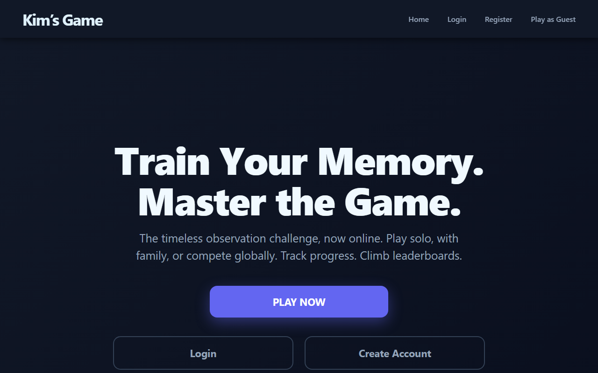
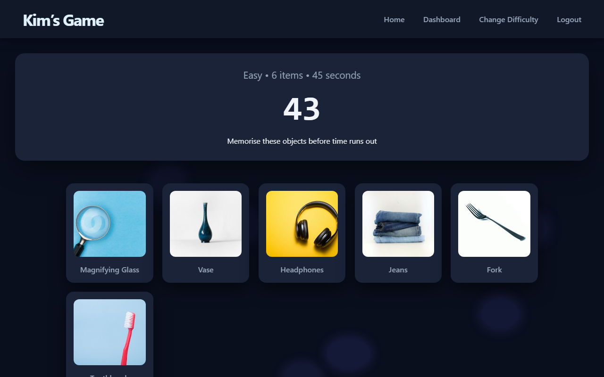
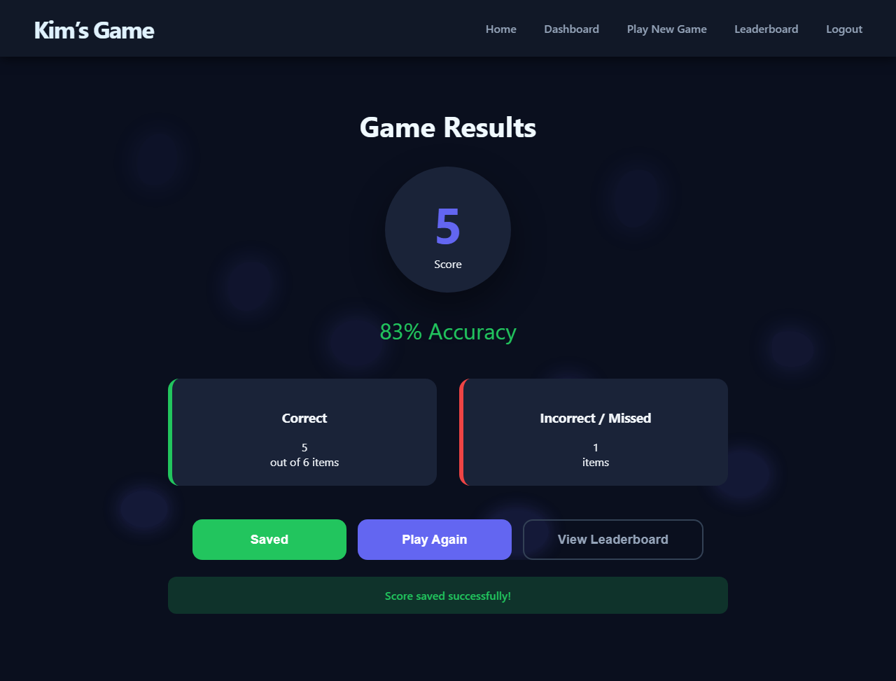
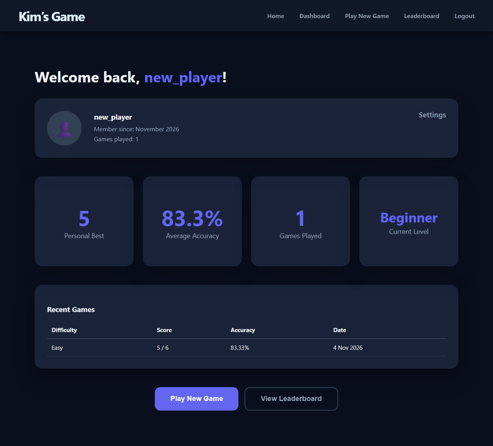
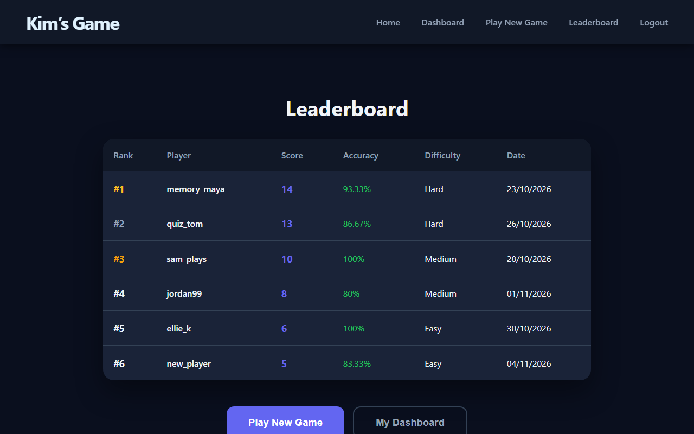

# Kim's Game

A browser version of Kim's Game, the classic memory exercise. You get a set of everyday objects and a short time to study them, then you type in as many as you can remember.



## How it plays

1. Choose a difficulty.

   | Level  | Objects | Time to study |
   | ------ | ------- | ------------- |
   | Easy   | 6       | 45 seconds    |
   | Medium | 10      | 30 seconds    |
   | Hard   | 15      | 20 seconds    |

2. The objects are drawn at random from a pool of 66, and each one is shown with a photo from Unsplash.
3. When the timer reaches zero, type the objects you remember. Order doesn't matter, and capital letters, spaces and hyphens are ignored.
4. Players with an account can save the result to their history and the global top 10. Guests can play without signing up.

| Study phase | Results |
| --- | --- |
|  |  |

| Dashboard | Leaderboard |
| --- | --- |
|  |  |

## Features

- Registration, login, profile editing and account deletion
- A dashboard with best score, average accuracy, games played, a level and the last 10 games
- A global leaderboard of the top 10 scores
- Guest play
- Layouts for desktop and phone

## Tech stack

- **Server:** Node.js, Express, express-session, express-rate-limit
- **Database:** MySQL or MariaDB through mysql2
- **Passwords:** bcryptjs
- **Images:** Unsplash API, called from the server
- **Front end:** plain HTML, CSS and JavaScript with no build step

## Security

- Passwords are hashed with bcrypt (12 rounds). The password rules shown on the sign-up form are checked again on the server.
- Every SQL query is parameterised.
- The session is regenerated at login. The cookie is HttpOnly and SameSite=Lax, and Secure when `COOKIE_SECURE=true`.
- Login and registration are rate limited to 20 attempts per IP every 15 minutes.
- An unknown email and a wrong password get the same error message and take the same time, so the login form doesn't reveal which emails have accounts.
- Usernames and other stored text are rendered with `textContent`, never as HTML.
- The server only accepts game results that are possible: a known difficulty, the right number of items and a score in range. It works out the accuracy itself.
- The Unsplash key stays on the server. The image endpoint only accepts short plain-word queries and caches each answer, which also keeps the app under Unsplash's rate limit.
- Request bodies are limited to 10 KB.

Scoring itself happens in the browser, so a player who edits the page can still post a perfect score. Fixing that would mean the server picking the objects and marking the answers.

## Getting started

Requirements:

- Node.js 18.11 or newer
- MySQL 8 or MariaDB 10.5 or newer
- An Unsplash access key from [unsplash.com/developers](https://unsplash.com/developers). This is optional. Without one, each object is shown as its name on a plain tile.

```bash
git clone <repository-url>
cd kims-game
npm install
```

Create a database and load the tables:

```bash
mysql -u root -p -e "CREATE DATABASE kims_game CHARACTER SET utf8mb4"
mysql -u root -p kims_game < schema.sql
```

Copy the example settings and fill them in:

```bash
cp .env.example .env
```

| Variable | Purpose |
| --- | --- |
| `PORT` | Port to listen on. Defaults to 3000. |
| `DB_HOST`, `DB_PORT`, `DB_NAME`, `DB_USER`, `DB_PASSWORD` | Database connection. |
| `SESSION_SECRET` | Long random string that signs the session cookie. Required. |
| `UNSPLASH_ACCESS_KEY` | Unsplash access key. Optional. |
| `COOKIE_SECURE` | Set to `true` when the site is served over HTTPS. |
| `TRUST_PROXY` | Set to `1` behind a reverse proxy so rate limiting sees the real client IP. |

To generate a session secret:

```bash
node -e "console.log(require('crypto').randomBytes(32).toString('hex'))"
```

Start the app:

```bash
npm start
```

Then open http://localhost:3000. `npm run dev` does the same but restarts when a file changes.

## Project structure

```
app.js                 Express server and API
schema.sql             Database tables
public/
  landing.html         Home page
  difficulty.html      Difficulty select
  observation.html     Study phase with the countdown
  recall.html          Type in what you remember
  results.html         Score and save
  dashboard.html       Stats, history and account settings
  leaderboard.html     Global top 10
  login.html
  register.html
docs/screenshots/      Images used in this README
```

Each page keeps its own CSS and JavaScript inline.

## API

| Method | Path | Login needed | Description |
| --- | --- | --- | --- |
| POST | `/api/register` | | Create an account |
| POST | `/api/login` | | Log in |
| POST | `/api/logout` | | Log out |
| GET | `/api/auth/me` | | Current login state |
| POST | `/api/game/save` | Yes | Save a finished game: `difficulty`, `score`, `num_items` |
| GET | `/api/leaderboard` | | Top 10 scores |
| GET | `/api/user/stats` | Yes | Best score, average accuracy, games played, join date |
| GET | `/api/user/game-history` | Yes | Last 10 games |
| POST | `/api/user/update-profile` | Yes | Change username, email or password |
| DELETE | `/api/user/delete-account` | Yes | Delete the account and its games |
| GET | `/api/image?q=<name>&size=small\|thumb` | | Photo URL for an object |

## Deployment

The app runs on any Node.js host. `app.js` only starts listening when it is run directly with `node`, so it can also be used as the startup file for Phusion Passenger, as on cPanel hosting.

## Credits

Object photos come from [Unsplash](https://unsplash.com). The project was built as a university development project.
